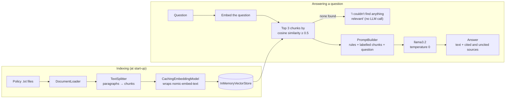

# DocumentQA: ask questions about company policies


DocumentQA answers questions about a set of company policy documents. Each answer is based only on the documents, cites the paragraph it came from, and says "I don't know" when the documents don't cover the question. Everything runs locally with [Ollama](https://ollama.com), so the documents are never sent to a cloud service. It can be used from the Console or through a small REST API built with Spring Boot.

It is a working prototype of the retrieval-augmented generation pattern (find the relevant text first, then ask a language model to answer from it). I built it from first principles in Java 21, without a RAG framework. It was tested on a small fictional corpus of 3 policies (39 paragraphs) and measured with an evaluation set of 20 questions. On the final setup, the right paragraph was retrieved for 15/15 answerable questions, 11/15 answers were correct when checked by hand, and 5/5 unanswerable questions were correctly refused.

## The problem

An employee with a question like "How many quotes do I need for a €4,000 laptop?" has to search through long policy documents. A general chatbot doesn't know the company's own rules and may invent a confident answer. A useful assistant needs to:

- answer **from the company's documents**, not from general knowledge;
- **show where the answer came from**, so the reader can check it;
- **refuse** when the documents don't contain the answer, instead of guessing;
- be **measured**, so that changes are judged by numbers rather than by how the answers look.

## How it works



1. **Load and split.** Every `.txt` file in `documents/` is split at blank lines, so each paragraph becomes one chunk. A paragraph longer than 120 words would be cut into overlapping 120-word windows; none in the current documents is that long. Each chunk has a unique key such as `procurement_policy.txt#4`.
2. **Embed.** Each chunk is turned into a vector of 768 numbers by `nomic-embed-text`, so that texts with similar meaning get similar vectors. Vectors are cached on disk, so unchanged paragraphs are never embedded twice.
3. **Retrieve.** The question is embedded the same way and compared with every chunk using cosine similarity (written by hand in `VectorMath`). The top 3 chunks scoring at least 0.5 are kept. If none pass, the language model is not called at all.
4. **Answer.** `PromptBuilder` gives `llama3.2` the rules (answer only from the context, cite the `[key]` after each fact, otherwise say "I don't know based on the documents."), the labelled chunks, and the question. Temperature 0 makes the answers repeatable.
5. **Check the sources.** `Answer` separates the chunks the answer actually cited from those that were retrieved but not cited, so the reader can see what the answer is based on.

## Example

**Answerable question**

```
QUESTION: Who needs to approve a €600 office chair?
ANSWER:   The employee's line manager needs to approve the purchase of an office chair under €1,000. [procurement_policy.txt#3]
Sources:
   procurement_policy.txt#3  (0.644)
  Retrieved but not cited:
    procurement_policy.txt#5  (0.687)
    procurement_policy.txt#4  (0.645)
```

**Question the documents don't cover**

```
QUESTION: How many days a week can I work from home?
ANSWER:   I don't know based on the documents.
```

## Running it

**Requirements**

- Java 21 and Maven
- [Ollama](https://ollama.com) running locally (default `http://localhost:11434`) with both models pulled:

```
ollama pull nomic-embed-text
ollama pull llama3.2
```

**Settings** live in `application.properties` in the project root:

| Setting | Value | Meaning |
|---|---|---|
| `documents.folder` | `documents` | Folder of `.txt` files to index |
| `ollama.embedding.model` | `nomic-embed-text` | Embedding model |
| `ollama.chat.model` | `llama3.2` | Chat model |
| `search.top-k` | `3` | Chunks given to the model |
| `search.min-score` | `0.5` | Lowest similarity counted as relevant |
| `embeddings.cache-file` | `cache/embeddings.json` | Saved vectors |
| `chunk.max-words` / `chunk.overlap-words` | `120` / `20` | Chunk size limits |

A missing or blank setting stops the program with an error naming the key.

**Programs** (run from the project root, for example with *Run As → Java Application* in an IDE):

- `com.example.documentqa.Main`: asks for one question, then prints the retrieved chunks with their scores, the answer, the cited sources, the sources retrieved but not cited, and how long indexing took (with cache hits and misses).
- `com.example.documentqa.Evaluator`: runs a question set through the real pipeline and prints one row per question plus the totals. Arguments are optional:
  - no arguments: `eval/questions.json` with `nomic-embed-text`
  - `eval/heldout.json`: the held-out set
  - `eval/questions.json bag-of-words`: the word-count baseline embedder instead of `nomic-embed-text`


**REST API** (Spring Boot). Start it from the project root:

```
mvn spring-boot:run
```

Documents are loaded and indexed once at startup, and the server listens on `http://localhost:8080`.

| Request | Response |
|---|---|
| `GET /health` | `{"status":"UP"}`: the web server is running (it doesn't check Ollama) |
| `POST /questions` with `{"question": "..."}` | The answer, plus every retrieved paragraph with its score and whether the answer cited it |
| Blank or missing `question` | 400 Bad Request |
| Ollama not reachable | 503 Service Unavailable |

Example:

```
curl -s -X POST http://localhost:8080/questions \
  -H "Content-Type: application/json" \
  -d '{"question":"Who needs to approve a €600 office chair?"}'
```

Response (formatted, scores rounded, two paragraphs shortened):

```json
{
  "answer": "The employee's line manager needs to approve the purchase of an office chair under €1,000. [procurement_policy.txt#3]",
  "sources": [
    { "key": "procurement_policy.txt#3", "score": 0.644, "cited": true,
      "content": "Purchases under €1,000 need one quote and approval from the employee's line manager." },
    { "key": "procurement_policy.txt#5", "score": 0.687, "cited": false,
      "content": "Purchases of €10,000 or more must go through a formal tender process ..." },
    { "key": "procurement_policy.txt#4", "score": 0.645, "cited": false,
      "content": "Purchases of €1,000 or more but under €10,000 need three written quotes ..." }
  ]
}
```

## Tests

```
mvn test
```

92 tests (JUnit Jupiter). They fall into two kinds:

- **Unit tests** use test doubles (`FakeEmbeddingModel`, `FakeChatModel`) instead of Ollama, so they are fast and give the same result every time. They cover cosine similarity edge cases (such as the zero vector), chunking, the vector store, search and the minimum score, prompt building, citation checking, the embedding cache, configuration errors, the evaluation's loader and scoring rules, and the REST API's status codes and JSON (with MockMvc, which sends requests to the controller without starting a server).
- **Integration tests** (`OllamaIntegrationTest`, 3 tests) call the real Ollama server to check the HTTP and JSON code. They are skipped, not failed, when Ollama isn't running.

GitHub Actions runs `mvn test` on every push and pull request. Ollama isn't available there, so the integration tests are skipped in CI.

Passing tests show the code does what it was written to do. They don't show the answers are correct (all tests passed while the system gave a wrong answer about the €4,000 laptop). That is what the evaluation measures.

## Evaluation and results

**Question sets** (in `eval/`):

- `questions.json`: 20 questions, 15 answerable and 5 that no policy covers. For each answerable question, the file records which paragraph holds the answer (`expectedSources`) and which facts the answer must contain (`expectedFacts`). These labels were checked by hand against the policies before any experiment was run.
- `heldout.json`: 5 questions on rules the main set doesn't use. Run once at the end and never used for tuning.

**What is measured** (by `AnswerScorer`, run by `Evaluator`):

| Measure | Meaning |
|---|---|
| Retrieved | The expected paragraph is in the top 3 returned by search |
| Cited | The answer cites the expected paragraph |
| Correct | The answer contains every expected fact |
| Wrongly refused | An answerable question got "I don't know" |
| Correctly refused | An unanswerable question got "I don't know" |

Retrieval and answering are measured separately because either can fail on its own. Every "correct" was also checked by reading the answer, and the numbers below are the hand-checked ones where they differ from the automatic score.

**Final setup** (`nomic-embed-text`, `llama3.2` at temperature 0, top-k 3, min-score 0.5):

| Measure | Main set | Held-out set |
|---|---|---|
| Retrieved (top 3) | 15/15 | 4/4 |
| Cited | 12/15 | 4/4 |
| Correct (checked by hand) | 11/15 | 2/4 |
| Wrongly refused | 1/15 | 0/4 |
| Correctly refused | 5/5 | 1/1 |

**Experiments**, each changing one thing on top of the best setup so far:

| Run | Retrieved | Correct | Decision |
|---|---|---|---|
| Baseline | 15/15 | 10/15 | |
| 1. Prompt line: compare amounts and dates with each rule's range | 15/15 | 11/15 | Kept (weak evidence: one question) |
| 2. Give the model only the top paragraph (top-k 1) | 12/15 | 8/15 | Rejected |
| 3. Larger chat model (`llama3.1:8b`) | 15/15 | 11/15 | Rejected: fixed one answer, broke another |
| 4. Word-count embeddings instead of `nomic-embed-text` (no threshold) | 10/15 | 6/15 | `nomic-embed-text` kept |

**Findings**

1. **The embedding model matters:** compared with word counting, `nomic-embed-text` found the right paragraph for 5 more questions and gave 5 more correct answers. Word counting misses when the question uses different words from the policy ("laptop" vs "purchases").
2. **Retrieval works; the answer step is the weak point.** The right paragraph was in the top 3 for every answerable question, on both sets.
3. **Comparing a number with a rule is `llama3.2`'s main weakness:** a €4,000 purchase placed in the "under €1,000" range, €700 called "below the €500 limit", a 23:30 taxi treated as not "after 22:00". The prompt line didn't fix this in general.
4. **A bigger model moved the errors instead of removing them.** `llama3.1:8b` fixed the €4,000 answer but confidently said an €80 gift can be accepted (the limit is €50).
5. **Refusals come from the prompt, not the minimum score:** with no threshold at all, all 5 unanswerable questions still reached the model and were refused.
6. **The scorer needed checking too.** Reading the answers by hand caught the automatic score overstating results 4 times, once because of a real bug (see below).

Full details for every run are in [`eval/results.md`](eval/results.md), and the problems found by hand testing before the evaluation are in [`eval/observations.md`](eval/observations.md).

**Embedding cache** (one run each, on my laptop): indexing the 39 chunks took 1136 ms without the cache and 2 ms with it. After editing one paragraph, 38 vectors came from the cache and 1 was newly embedded.

## Design decisions

- **Interfaces for each replaceable part** (`EmbeddingModel`, `ChatModel`, `VectorStore`). The rest of the code doesn't know which model or store it uses: the word-count experiment swapped in a different `EmbeddingModel` class without changing the search code, and the tests swap in fakes. A database-backed `VectorStore` could replace the in-memory one later. Model names are settings in `application.properties`, so trying `llama3.1:8b` needed no code change.
- **The cache is a decorator.** `CachingEmbeddingModel` is itself an `EmbeddingModel` that wraps the real one, so search code doesn't know caching exists. The cache key is a SHA-256 hash of the model name and the text, so changing the model or a paragraph can never return a stale vector.
- **Test doubles instead of Ollama in unit tests**, so tests are fast, repeatable and run in CI without a model server.
- **Scoring rules are pure static functions** (`AnswerScorer`): no state and no I/O, so each rule is easy to unit test. That is how the scorer bug was pinned down with a test before it was fixed.
- **Two layers of refusal:** if no chunk passes the minimum score, the model isn't called; if chunks are found but don't contain the answer, the prompt tells the model to say it doesn't know.
- **Citations are checked in code,** not trusted. `Answer` compares the `[key]` labels in the text with the chunks actually retrieved.
- **Temperature 0 before measuring,** so a change in the score comes from the change being tested, not from chance.
- **Runs locally:** policy documents stay on the machine.
- **Built from scratch** (cosine similarity, chunking, vector store, prompt, evaluation) to understand each step before using a framework.
- **One shared pipeline set-up** (`Pipeline.build`) for `Main`, `Evaluator` and the REST API, so the API answers with exactly the system that was evaluated. I checked this refactor by re-running the evaluation and getting identical totals.
- **Spring Boot only at the edge.** The controller translates between JSON and the existing classes; the answering logic stays in plain Java, so it can be tested without a server.
- **Status codes say whose problem it is:** 400 for a blank question (the client's mistake), 503 when Ollama is down (a dependency, so retrying later may work), instead of a 500 that looks like a bug.

## Challenges and debugging

All entries are in [`DEBUGGING.md`](DEBUGGING.md). Some that shaped the project:

- **The evaluation reported wrong answers as correct.** "You need one quote ... [procurement_policy.txt#3]" passed the check for "three quotes", because the fact check also searched the citation label and `#3` contains a 3. The automatic score was 12/15 and the real one 10/15. I wrote a test reproducing the case first, then removed citation labels before matching ([47f2919](https://github.com/ElvitaPaskauskaite/DocumentQA/commit/47f2919)).
- **The model said "I don't know" with the right paragraph in front of it.** Printing the exact prompt showed the question was never added to it ([a0b333f](https://github.com/ElvitaPaskauskaite/DocumentQA/commit/a0b333f)). The lesson was to check the input before blaming the model.
- **Off-topic questions still returned chunks**, with a similarity of 0.000, because search always returned the top results however weak they were. Fixed with a minimum score ([eea73bd](https://github.com/ElvitaPaskauskaite/DocumentQA/commit/eea73bd)).
- **Chunk ids collided across files.** Every file numbered its chunks from 1, so the second document would have overwritten the first one's vectors. Keys now combine file name and position ([7874561](https://github.com/ElvitaPaskauskaite/DocumentQA/commit/7874561)).
- **A confident answer that the citations exposed.** For the €4,000 laptop, the right paragraph ("€1,000 or more but under €10,000 need three quotes") was retrieved, but the answer said one quote and cited the "under €1,000" paragraph. The same wrong answer came back in 3 of 3 runs, so it was a repeatable model error, not randomness. This is why the program shows which sources were retrieved but not cited.

## Limitations and next steps

**Limitations of this prototype**

- Tested on a small fictional corpus: 3 policies, 39 paragraphs, 20 main questions. The settings were tuned on those same 20 questions, and the held-out check has only 4 answerable questions, too few to measure overfitting on its own.
- The keyword scorer can't judge yes/no answers: it marked 3 wrong ones correct because the right number appeared in a wrong answer. Hand-checked numbers are reported above.
- The citation check misses several labels inside one bracket and doesn't detect invented labels.
- The embedding cache never removes old entries, and a corrupt cache file stops the program.
- Only flat folders of `.txt` files are loaded, and chunk size is measured in words, not model tokens.
- The REST API is for one local user: there is no login, and requests share an embedding cache (a plain `HashMap`) that isn't safe for simultaneous writes.

**What a production version would still need:** access control (who may see which document), support for PDF and Word files, a persistent vector database, a much larger evaluation set built from real employee questions, comparing amounts and dates in code instead of asking the model, monitoring of answers in use, and protection against instructions hidden inside documents.

**Next steps**

- Login and safe handling of several requests at once, so the REST API could serve more than one local user.
- An `expectedAnswer` (yes/no) field so the scorer can judge yes/no answers.
- More unanswerable questions, so that the minimum score and excluding header paragraphs can be measured.
- A `VectorStore` backed by a database with vector search, such as SAP HANA Cloud's vector engine.

## Repository layout

| Path | Contents |
|---|---|
| `src/main/java/com/example/documentqa/` | The application: loading, splitting, embedding, search, prompt, answer, evaluation, REST API |
| `src/test/java/com/example/documentqa/` | JUnit tests (including MockMvc tests for the REST API) and the two test doubles |
| `documents/` | The 3 fictional Acme Ltd policies that are indexed |
| `eval/` | Question sets, `results.md` (every measured run) and `observations.md` (problems found by hand) |
| `samples/dev-notes/` | Early test documents (Java and Git notes), kept because older debugging entries refer to them; not indexed |
| `DEBUGGING.md` | Bugs found: symptom, cause, fix, lesson |
| `application.properties` | Settings |